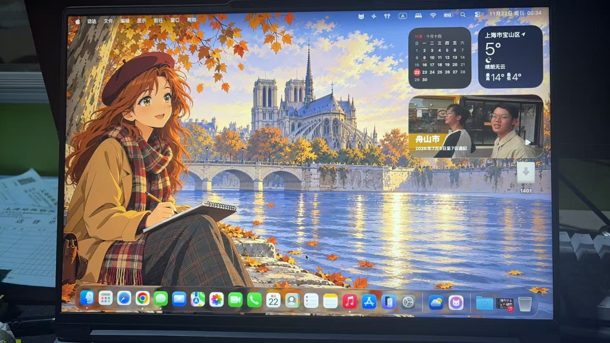
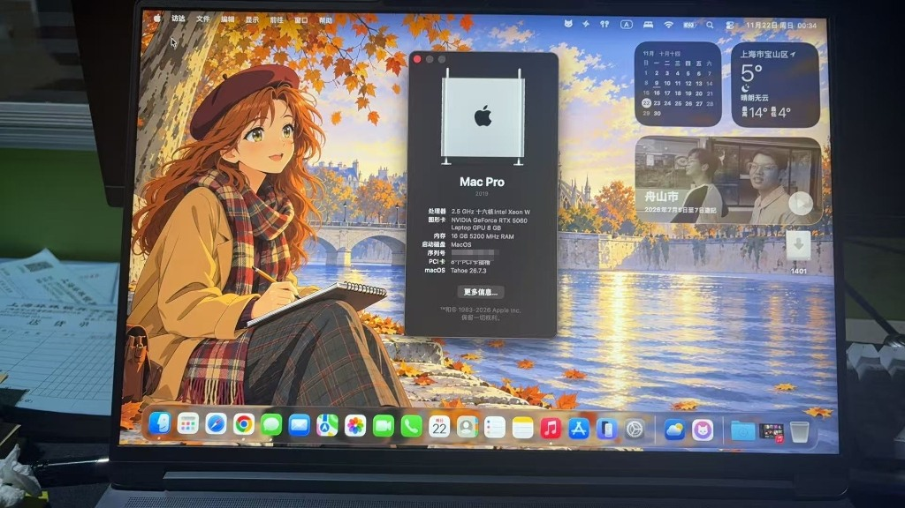
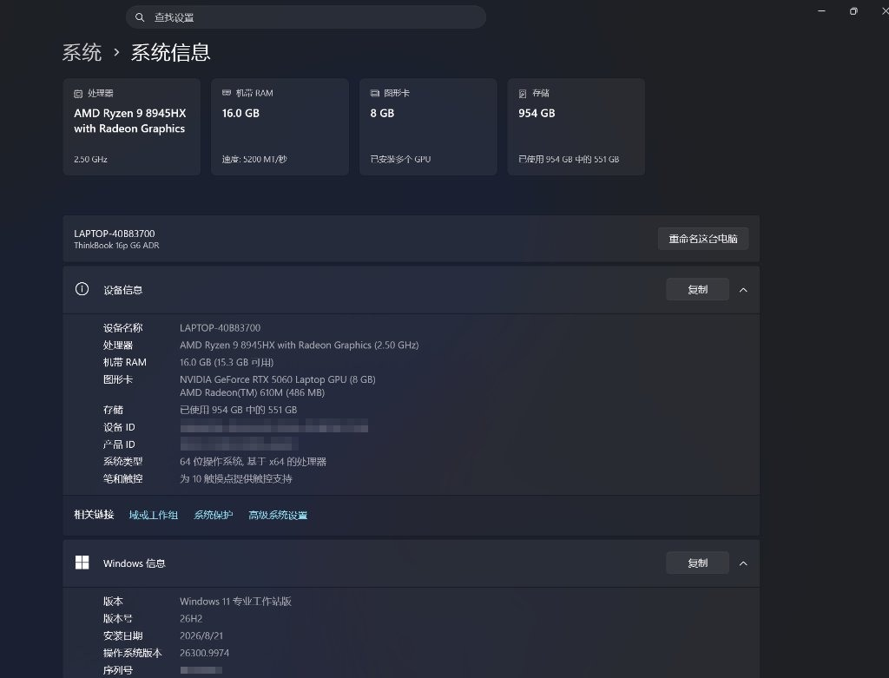

# Lenovo ThinkBook 16p 2025 (G6 ADR) Hackintosh EFI — macOS 26 Tahoe

<p align="center">
  <b>English</b> | <a href="README.zh-CN.md">简体中文</a>
</p>

**OpenCore 1.0.9** Hackintosh EFI and complete installation guide for the **Lenovo ThinkBook 16p 2025 (G6 ADR / Model `21U0`)**, powered by **NullMoth `1401` + `nvidia-macos-driver` v3.0** for **NVIDIA GeForce RTX 5060 Laptop GPU** Metal 3 acceleration, tested and verified on **macOS 26.7.3 (Tahoe)**.

> **Disclaimer & Safety Notes**
> 1. `PlatformInfo > Generic` (Serial Number / MLB / UUID / ROM) in this repository is sanitized with placeholders. **You MUST generate your own SMBIOS (`MacPro7,1`) before booting.**
> 2. **NEVER disable `Booter > Quirks > DisableVariableWrite = True` on this AMD platform** while `DevirtualiseMmio` or `SetupVirtualMap` is enabled — direct macOS NVRAM writes can cause certain AMD motherboards to fail POST.

---

## Screenshots

| macOS 26.7.3 Tahoe Desktop (Liquid Glass & Native Wi-Fi 7) | About This Mac (RTX 5060 8 GB Metal 3) |
| :---: | :---: |
|  |  |

<details>
<summary>Windows 11 Hardware Verification (ThinkBook 16p G6 ADR / Ryzen 9 8945HX / RTX 5060)</summary>



</details>

---

## Hardware Specifications & Status

| Component | Specification | Status | Driver / Notes |
|---|---|---|---|
| **Laptop / Board** | Lenovo ThinkBook 16p 2025 (G6 ADR, `21U0`, `LNVNB161216`) | Working | BIOS `R7CN28WW` (Discrete GPU / dGPU-Direct mode required) |
| **CPU** | AMD Ryzen 9 8945HX (Dragon Range / Zen 4, 16C/32T) | Working | AMD Vanilla Patches + `ForgedInvariant.kext` v1.5.0 |
| **dGPU** | NVIDIA GeForce RTX 5060 Laptop GPU (`10DE:2D59`, 8 GB) | Working | **Full Metal 3 hardware acceleration** via NullMoth v3.0 |
| **iGPU** | AMD Radeon 610M (`1002:164E`) | Disabled | Disabled via `DeviceProperties` (`disable-gpu`) |
| **Internal Display** | CSOT `MNG007DA6-2` (2560×1600, eDP, wired to dGPU) | Working | Brightness & `F5`/`F6` hotkeys work (see Known Limitations) |
| **Wi-Fi** | MediaTek Wi-Fi 7 MT7925 (`14C3:7925`, `17AA:E0FF`) | Working | `WTLWireless.kext` v0.15.0 + `WTLWirelessNative.kext` (**Native Wi-Fi icon on 26.7.1–26.7.3**) |
| **Bluetooth** | MediaTek Bluetooth (`0489:E111`) | Working | `BlueToolFixup` v2.7.2 + `LegionBtFix` v0.3.0 + `WTLWirelessBt` v0.15.0 |
| **Audio** | Realtek ALC3287 / ALC257 (`10EC:0257`, `17AA:3E22`, AMD `1022:15E3`) | Working | **`SimpleHDA` v1.0.1 + `AppleALC` v1.9.9** (`layout-id = 18` + `nmxaudio=2`), both internal stereo speakers & 3.5mm auto-switching work |
| **HDMI/DP Audio** | NVIDIA High Definition Audio (`10DE:22EB`) | Working | `NMXAudio.kext` (`nmxaudio=2` restricts it to NVIDIA HDMI/DP only) |
| **Touchpad** | I2C HID Touchpad (`SYNA2BA6`) | Working | `VoodooI2C` + `VoodooI2CHID` + `-vi2c-force-polling` (`VoodooGPIOAMD` stripped to prevent boot hang) |
| **Keyboard & Hotkeys** | PS/2 Keyboard (`KBC8042`) + `F5`/`F6` Brightness Keys | Working | `VoodooPS2Controller` v2.3.8 (`ps2kbdonly=1 ps2rst=0`) + `BrightnessKeys` v1.0.4 |
| **NVMe SSD** | UMIS 1 TB NVMe (`1CC4:6C14`) | Working | `NVMeFix.kext` v1.1.4 |
| **Battery** | ACPI Battery | Working | `VirtualSMC` + `SMCBatteryManager` |
| **Bootloader & Security** | OpenCore 1.0.9 + UEFI Secure Boot | Working | Graphical `OpenCanopy` (`Acidanthera\GoldenGate`); **UEFI Secure Boot verified** (`UEFISecureBootEnabled = 1`) with custom signed `.efi` + Lenovo factory keys |

### Known Limitations
- **Backlight Low-Brightness Wrap-Around**: NullMoth v3.0 has a known bug on this eDP panel (`DPCD 0x701=0x9b 0x702=0xa7`, [nvidia-macos-driver #556](https://github.com/nullmoth/nvidia-macos-driver/issues/556)). Hardware brightness works smoothly from **25%–100%**, but wraps back to full brightness below ~20%. If you need smooth 0%–100% dimming, add `nvfbedpbl=0` to `boot-args` and use open-source **MonitorControl** (or **BetterDisplay**) for software dimming via `F5`/`F6`.
- **AirDrop / Sidecar**: The MediaTek MT7925 driver does not yet implement Apple's proprietary AWDL protocol ([WTLWireless #8](https://github.com/watchthelight-labs/WTLWireless/issues/8)). Use free & open-source **LocalSend** for fast cross-device LAN file transfers.
- **Sleep / Wake**: Upstream `WTLWireless` does not officially implement sleep/wake handling yet. However, on this laptop (macOS 26.7.3 with `WTLWireless` v0.15.0 + `WTLWirelessBt` v0.15.0), a short manual sleep (~1.5 minutes) and wake succeeded with **no kernel panic** — both Wi-Fi (`"MtkState" = "W6 pass: en1 passing traffic"`) and Bluetooth (with AirPods connected; `"MtkBtState" = "ready"`, `"MtkBtStep" = "done"`) remained working. Extended / deep sleep stability still needs further observation.

---

## Key Platform Fixes Included in This EFI

If you are building a Hackintosh on a similar AMD Ryzen 9 8945HX (Dragon Range) + RTX 5060/5070 Laptop, the following fixes are already integrated:

1. **Fix `pci (build ...)` Boot Hang** (classic AMD 8945HX + RTX 5060 stall):
   - Enabled kernel patch `CaseySJ | IOPCIIsHotplugPort | Fix PCI bus enumeration on AM5 | 13.0+`;
   - Blocked `com.apple.iokit.IONDRVSupport` under `Kernel > Block`;
   - Added `ForgedInvariant.kext` v1.5.0 (Zen 4 TSC synchronization);
   - Disabled `WhateverGreen.kext`, switched SMBIOS to `MacPro7,1` (`ProcessorType = 3841`, `CustomSMBIOSGuid = True`);
   - Enabled `DisableRtcChecksum = True`, `LapicKernelPanic = True`, `DevirtualiseMmio = True` + full sub-4G `MmioWhitelist` (including `0xFF000000`) + `DisableVariableWrite = True` + `ResizeAppleGpuBars = 0` (for installation).
2. **Fix Lenovo AMD Laptop `VoodooGPIOAMD` Hang**:
   - Kept `VoodooGPIO.kext` for `VoodooI2C` symbol resolution, stripped the `VoodooGPIOAMD` personality from `Contents/Info.plist`, and paired with `-vi2c-force-polling` to drive the `SYNA2BA6` I2C touchpad cleanly.
3. **Fix Silent Internal Speakers on macOS 26 Tahoe**:
   - macOS 26 removes vanilla `AppleHDA.kext`; NullMoth's `NMXAudio.kext` only outputs to the 3.5mm headphone jack on this laptop (missing Lenovo ALC257/ALC3287 speaker EAPD/COEF initialization).
   - Integrated **`SimpleHDA.kext` v1.0.1** to dynamically restore vanilla `AppleHDA` via OpenCore (without breaking the APFS root seal), loaded strictly in `Lilu → AppleALC → SimpleHDA` order, with `DeviceProperties` `layout-id = <12000000>` (`18`) and **`nmxaudio=2`** in `boot-args` (restricting `NMXAudio` to NVIDIA HDMI/DP only).
4. **Fix Intermittent OpenCore Keyboard Freeze on Lenovo Insyde H2O BIOS**:
   - Added **`ps2kbdonly=1 ps2rst=0`** to `boot-args` to prevent `VoodooPS2Controller` from probing non-existent PS/2 mouse ports or hard-resetting the 8042 EC across warm macOS reboots;
   - Set `UEFI > Input` `TimerResolution = 0` (respecting Insyde's native 10ms timer), `KeyFiltering = True`, and `TakeoffDelay = 500000`;
   - Disabled Windows Fast Startup (`HiberbootEnabled = 0`).

---

## Complete Installation Guide

### 1. BIOS & Hardware Prerequisites
Press `F2` at boot to enter Lenovo BIOS:
1. **Graphics Mode (Required)**: Switch to **Discrete Graphics (dGPU Direct)** in BIOS or Lenovo Vantage / Legion Zone so the internal eDP panel is wired directly to the RTX 5060.
2. **Secure Boot**: Set to **Disabled** during initial installation (you can re-enable UEFI Secure Boot afterward — see Step 6).
3. **Fast Boot**: Set to **Disabled**.
4. Disable Windows Fast Startup in Windows (prevents EC keyboard lockouts and NTFS dirty-mount issues in dual-boot):
   ```cmd
   reg add "HKLM\SYSTEM\CurrentControlSet\Control\Session Manager\Power" /v HiberbootEnabled /t REG_DWORD /d 0 /f
   ```

---

### 2. Create the macOS 26 Tahoe Installer USB
1. Prepare a ≥ 16 GB USB flash drive (will be erased; back up your data first).
2. Download the latest `1401` Windows tool from [nullmoth/1401 Releases](https://github.com/nullmoth/1401/releases) and build the **macOS 26 Tahoe** Recovery USB (this automatically writes `com.apple.recovery.boot` plus the offline `NullMoth/` GPU driver package and NVIDIA firmware).
3. **Replace EFI**: Delete the `EFI` folder on the USB drive and copy this repository's `EFI` folder to the USB root.
4. **Generate Your Own SMBIOS**:
   - Run [GenSMBIOS](https://github.com/corpnewt/GenSMBIOS), pick **`MacPro7,1`**, and generate new `SystemSerialNumber`, `MLB`, and `SystemUUID`.
   - Open `EFI/OC/config.plist` with ProperTree / OCAT and replace the placeholders under `PlatformInfo > Generic`.
5. **Copy Helper Scripts to USB** (already normalized to Unix `LF` line endings in `Scripts/`):
   - Copy `Scripts/WTLWireless-Recovery/` to the USB root and rename it to `WTLWireless/` (for Wi-Fi in macOS Recovery);
   - Overwrite `NullMoth/finish-setup.sh` on the USB with `Scripts/finish-setup.sh` (prevents `CRLF` `set: invalid option` errors in Recovery Terminal).

---

### 3. Boot from USB & Install macOS 26.7.3
1. Reboot, press `F12` to select the USB drive, and choose **`1401`** (macOS Recovery) in OpenCore.
2. **Connect to Wi-Fi in Recovery**:
   - Open **Utilities → Terminal** from the top menu bar and run:
     ```bash
     diskutil mount 1401
     bash /Volumes/1401/WTLWireless/recovery-wifi.sh
     ```
     *(If `diskutil mount 1401` says volume not found, run `diskutil list` to find the `1401` partition identifier e.g. `disk2s1`, then `diskutil mount disk2s1`.)*
3. Open **Disk Utility**, erase your prepared macOS partition as **APFS** (e.g., named `MacOS`), and close Disk Utility.
4. Select **Reinstall macOS Tahoe**, choose the `MacOS` partition, and let it download and install.
5. The installer will **automatically reboot 3–4 times**:
   - Because `DisableVariableWrite = True` is enabled for AMD safety, manually select **`macOS Installer`** in OpenCore on each reboot;
   - After the final stage, `macOS Installer` becomes **`MacOS`** (alongside `Recovery 26.7.3`). The first boot into `MacOS` will finish the progress bar and reboot once more cleanly.

---

### 4. Bypass Black-Screen Setup Assistant (Known macOS 26 Issue)
Before the RTX 5060 driver is installed, macOS 26 cannot render the initial Setup Assistant UI and shows a **black screen with only a white cursor** (1401 Issue #86). Bypass it in 1 minute:
1. Reboot into OpenCore and select **`Recovery 26.7.3`**.
2. Open **Utilities → Terminal**, mount the USB, and run:
   ```bash
   diskutil mount 1401
   sh /Volumes/1401/NullMoth/finish-setup.sh
   ```
   *(If you get `: invalid option`, strip Windows carriage returns first: `tr -d '\r' < /Volumes/1401/NullMoth/finish-setup.sh > /tmp/fs.sh && sh /tmp/fs.sh`.)*
3. Follow the prompts to enter a lowercase username, full name (press Enter), and password (twice). The script creates your admin account, writes `.AppleSetupDone`, and temporarily enables auto-login.
4. Type `reboot` and select **`MacOS`** in OpenCore to land directly on the macOS 26.7.3 desktop (unaccelerated UI will be sluggish at first — give it 20–30 seconds).

---

### 5. Install RTX 5060 Metal 3 Driver
1. On the desktop, open `NullMoth/` on the `1401` USB drive, extract and run **`1401-Mac-3.0.zip`** (if Gatekeeper blocks it, run `xattr -cr ~/Downloads/1401.app` in Terminal).
2. Follow `1401.app` to install the driver (it automatically uses the offline `nullmoth-nvidia-3.0.tar.gz` and NVIDIA firmware from the same folder, and adds the `NullMothSafe` fallback tool to OpenCore).
3. Reboot into `MacOS` and enjoy **full RTX 5060 Metal 3 acceleration**, **native Wi-Fi 7**, **internal speakers & headphones**, and **I2C touchpad**!
4. Once the login screen renders normally, disable the temporary "Automatic Login" in **System Settings → Users & Groups**.

---

### 6. Post-Install Polish (Recommended)
1. **Fix 8-Hour Dual-Boot Time Drift (Windows vs macOS)**:
   - Right-click **`Scripts/Fix-Windows-UTC-Time.bat`** in Windows → **Run as Administrator** (sets `RealTimeIsUniversal = 1` and forces an NTP resync).
2. **Boot Directly from Internal SSD (No USB Needed)**:
   - Copy `EFI/OC` into your internal NVMe ESP at `\EFI\OC` (**do NOT overwrite `\EFI\Microsoft`**), then register `\EFI\OC\OpenCore.efi` as the first UEFI boot entry via `bcdedit` or BIOS.
3. **Optional — Clean Apple Logo Boot (Disable Verbose `-v`)**:
   - Once everything is stable, remove `-v` from `NVRAM > Add > 7C436110-AB2A-4BBB-A880-FE41995C9F82 > boot-args` and set `Misc > Debug > Target = 3`. You can still hold `Win + V` (`Cmd + V`) after selecting macOS in OpenCore for one-time verbose logging.
4. **Optional — Re-Enable UEFI Secure Boot (Verified Working)**:
   - Set `UEFI > Quirks > DisableSecurityPolicy = True` in `config.plist` (keeps `Misc > Security > SecureBootModel = Disabled` for NullMoth's unsigned kexts, while allowing Apple's `boot.efi` to pass firmware verification);
   - Generate your own RSA-2048 SHA-256 Authenticode certificate, sign all 6 `.efi` binaries in `EFI/OC/` (`OpenCore.efi`, `HfsPlus.efi`, `OpenCanopy.efi`, `OpenRuntime.efi`, `ResetNvramEntry.efi`, `NullMothSafe.efi`), enter BIOS **Setup Mode** (Clear/Reset Secure Boot Keys), enroll Lenovo's factory `dbxDefault` + `dbDefault` + your custom cert into `db` + `KEKDefault` + Lenovo's original `PKDefault`, and re-enable Secure Boot in BIOS.

---

## Credits & Licenses

This repository builds upon the amazing open-source Hackintosh community (original component licenses are included in `LICENSES/`):

- [Acidanthera / OpenCorePkg](https://github.com/acidanthera/OpenCorePkg) & `Lilu`, `VirtualSMC`, `AppleALC`, `RestrictEvents`, `BlueToolFixup`, `NVMeFix`, `VoodooPS2`, `BrightnessKeys`
- [NullMoth / 1401](https://github.com/nullmoth/1401) & [nvidia-macos-driver](https://github.com/nullmoth/nvidia-macos-driver) (RTX 5060 Metal 3 driver & 1401 builder)
- [watchthelight-labs / WTLWireless](https://github.com/watchthelight-labs/WTLWireless) & [WTLLegionBtFix](https://github.com/watchthelight-labs/WTLLegionBtFix) (MediaTek MT7925 native Wi-Fi 7 & Bluetooth)
- [laobamac / SimpleHDA](https://github.com/laobamac/SimpleHDA) (Dynamic vanilla AppleHDA restoration on macOS 26 Tahoe)
- [AMD-OSX / AMD_Vanilla](https://github.com/AMD-OSX/AMD_Vanilla) & [ChefKissInc / ForgedInvariant](https://github.com/ChefKissInc/ForgedInvariant)
- [VoodooI2C / VoodooI2C](https://github.com/VoodooI2C/VoodooI2C) & [USBToolBox / kext](https://github.com/USBToolBox/kext)
- [dortania / OpenCore-Install-Guide](https://dortania.github.io/OpenCore-Install-Guide/)
