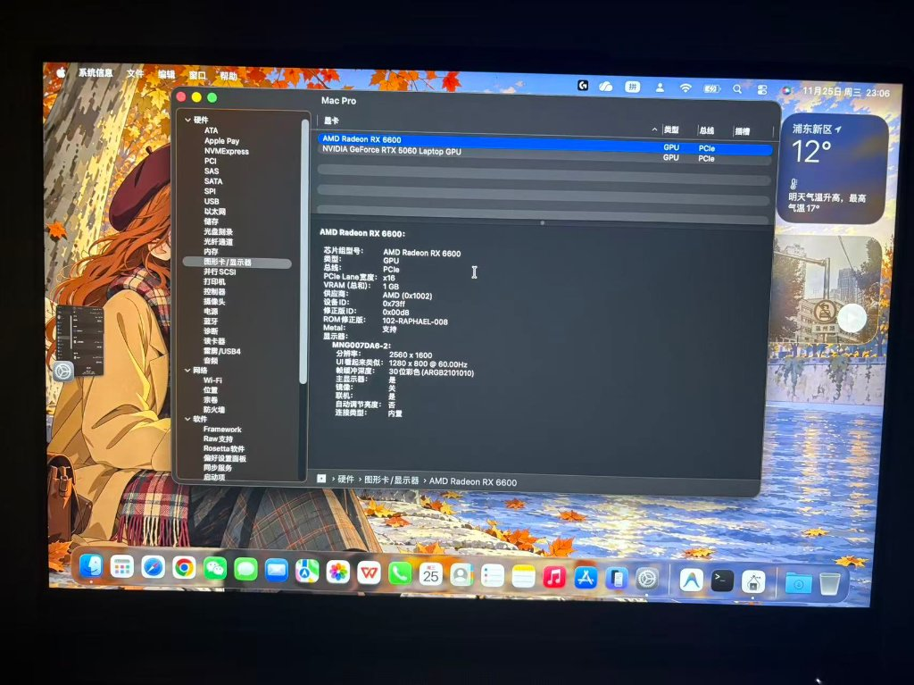

# Lenovo ThinkBook 16p 2025 (G6 ADR) Hackintosh EFI — AMD Radeon 610M iGPU (`RembrandtGfx`, `v0.1.0-alpha`)

<p align="center">
  <b>English</b> | <a href="README.zh-CN.md">简体中文</a>
</p>

> **Branch Notice (`igpu-610m-rembrandtgfx` — Early Bring-Up `v0.1.0-alpha`)**
> - This branch provides the **experimental AMD Radeon 610M (`1002:164e`) iGPU + Dual-GPU OpenCore 1.0.9 EFI** powered by a custom-ported **`RembrandtGfx.kext`** (ported from [caoshiyuan0211-blip/winmax2-2022-6800u-hackintosh](https://github.com/caoshiyuan0211-blip/winmax2-2022-6800u-hackintosh) to **Raphael / `gfx1036`**, spoofing `0x73ff` RX 6600 on **macOS 26.7.4 (`25G422`)**) alongside **NullMoth 3.1** for the RTX 5060 Laptop GPU.
> - Looking for the **stable daily-driver dGPU-only (RTX 5060) EFI**? Switch to the [`main`](https://github.com/Yangcheng811/ThinkBook-16p-2025-G6-ADR-Hackintosh/tree/main) branch (`v1.1.0`).
> - **SMBIOS Sanitized**: `PlatformInfo > Generic` contains placeholder values — **generate your own `MacPro7,1` SMBIOS before booting**.

---

## Screenshots (macOS 26.7.4 Tahoe — Hybrid / Dual-GPU Mode)

| About This Mac (`AMD Radeon RX 6600 1 GB`) | System Information (610M `0x73ff` Metal + RTX 5060) |
| :---: | :---: |
|  |  |

---

## What Works (`v0.1.0-alpha`)

- **AMD Radeon 610M (`1002:164e`, Rev `0xd8`, Raphael `gfx1036`, 2 CU) Metal Acceleration**:
  - Ported `RembrandtGfx.kext` to Raphael (`0x164e` → `0x73ff` RX 6600, `KernelVersion::Tahoe`, `linux-firmware` `psp_13_0_5_*` / `gc_10_3_6_*` / `sdma_5_2_6` / `dcn_3_1_5_dmcub`, SMU 13.0.5 message IDs `0x0A` / `0x17`, PowerPlay `wrapUpdateHWInfoClocks`, scanout DCC disabled via `wrapShouldAllocScanoutDcc -> 0`).
  - Boots into macOS 26.7.4 (`25G422`) desktop at native `2560 × 1600` (30-bit ARGB2101010) with **Metal hardware acceleration** (`102-RAPHAEL-008`, `1 GB` VRAM).
- **DarkWake / Clamshell ~21s Black Screen Fixed**:
  - Added `clamshell-sleep` block in `sleep.cpp` (`RembrandtGfx: sleep: clamshell-sleep block active`), eliminating DarkWake / `setOutputPowerState(1)` black screens at boot.
- **NVIDIA RTX 5060 Laptop GPU (`10de:2d59`, `17aa:8036`) Co-Enabled**:
  - Unblocked `com.nullmoth.*` and configured `nvfb=1 nvaccel=1 nvfbheads=4 -nvkmsnosmooth nmxaudio=2` for NullMoth 3.1 (`NVRM-xnu` & `NVAccel` load cleanly: `NVAccel: createUserGPUTask -> init=1`).

---

## Known Issues & TODO (Important — Alpha Release)

1. **[Stability Blocker] Occasional Gray Screen / `WindowServer` Watchdog Timeout Deadlock**:
   - **Symptom**: After sitting idle or light desktop use, the screen may turn gray/freeze and reboot after ~40s (`WindowServer.userspace_watchdog_timeout.spin`).
   - **Exact Root Cause Identified**: When `IOAccelEventMachine2::hardwareErrorEvent()` calls `AMDRadeonX6000_AMDAccelChannel::getHardwareDiagnosisReport` → `AMDRadeonX6000_AMDNavi23Hardware::collect_stb(AmdStbInfo*)`, reading STB registers `0xecc182` / `0xecc183` returns non-zero unequal values; once loop count exceeds `0x7ff` (2048), the branch skips re-reading `0xecc182` and spins forever while holding the `AMDRadeonX6000_AMDAccelEventMachine` lock, starving `ws_main_thread` and `HIDEvents` until the 40s Watchdog trips.
   - **Planned Fix (Next Release)**: Hook `__ZN32AMDRadeonX6000_AMDNavi23Hardware11collect_stbEP10AmdStbInfo` in `probe.cpp` to return `false` directly (verified in `AMDRTHardware::writeSTBDiagnosisReport` disassembly to skip STB output and free the `0x400c` buffer cleanly with no leak).
2. **1024 MB UMA VRAM Exhaustion (`AMD ERROR! Failed to allocate`)**:
   - BIOS allocates `FB: 1024 MB, Aper: 256 MB` to the 610M iGPU (`ResizeAppleGpuBars` does not enlarge the BIOS aperture). High-resolution `WindowServer` + Metal/Electron apps can exhaust the 1024 MB pool within 50–160s (`free memory remaining` drops toward `0–139 MB`). Increasing UMA Frame Buffer Size in BIOS (if available) is recommended.
3. **Other Known Limitations**:
   - **Minimum Brightness Black Screen**: Setting internal panel brightness to minimum under iGPU still turns the backlight completely off.
   - **Sleep / Wake**: Experimental; current `config.plist` passes `-rmbnousb4sleep -rmbnohalt -rmbnomode2 -rmbnosleep -rmbnodispsleep` to bypass sleep paths.
   - **Short-Uptime Reboots (75–160s)**: Some rapid reboots without `.ips` crash reports need further observation once the `collect_stb` deadlock is patched.

---

## Current Test EFI Configuration Summary

- **`boot-args`**:
  ```text
  -v debug=0x100 keepsyms=1 nvfb=1 nvaccel=1 nvfbheads=4 -nvkmsnosmooth amfi_get_out_of_my_way=0x1 amfi=0x80 ipc_control_port_options=0 gfxrst=4 -vi2c-force-polling mtkfe=native mtknativeif=1 revpatch=sbvmm nmxaudio=2 ps2kbdonly=1 ps2rst=0 -lilubetaall -rmbnousb4sleep -rmbnohalt -rmbnomode2 -rmbnosleep -rmbnodispsleep
  ```
- **Recommended Deployment**: Test this branch on an **external USB drive (`OC_USB`)** first — keep your internal SSD's stable `main` (RTX 5060 dGPU-only) EFI untouched.
- **Validation**: `EFI/OC/config.plist` validated with `ocvalidate 1.0.9` (0 issues; `ResizeAppleGpuBars = 0`).

---

## Credits

- Upstream iGPU bring-up architecture: [caoshiyuan0211-blip / winmax2-2022-6800u-hackintosh](https://github.com/caoshiyuan0211-blip/winmax2-2022-6800u-hackintosh) (`RembrandtGfx`)
- Full platform credits & component licenses: see `LICENSES/` and [`main` README](https://github.com/Yangcheng811/ThinkBook-16p-2025-G6-ADR-Hackintosh/blob/main/README.md).
