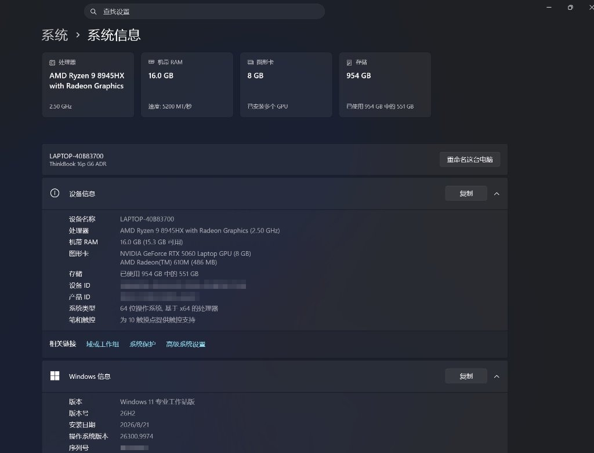

# Lenovo ThinkBook 16p 2025 (G6 ADR) Hackintosh EFI — macOS 26 Tahoe

<p align="center">
  <a href="README.md">English</a> | <b>简体中文</b>
</p>

适用于 **联想 ThinkBook 16p 2025（G6 ADR / 型号 `21U0`）** 的 **OpenCore 1.0.9** 黑苹果 EFI 与完整安装指南，基于 **NullMoth `1401` + `nvidia-macos-driver` v3.0** 驱动 **RTX 5060 Laptop GPU**（Metal 3 硬件加速），实测运行 **macOS 26.7.3 (Tahoe)**。

> **免责声明与安全提示**
> 1. 本仓库中的 `PlatformInfo > Generic`（序列号 / MLB / UUID / ROM）已脱敏为占位符，**使用前必须自行生成三码**（机型 `MacPro7,1`）。
> 2. **AMD 平台严禁关闭 `Booter > Quirks > DisableVariableWrite = True`**（当开启 `DevirtualiseMmio` 或 `SetupVirtualMap` 时，macOS 直接写固件 NVRAM 可能导致部分 AMD 主板无法 POST）。

---

## 实机截图

| macOS 26.7.3 Tahoe 桌面（Liquid Glass & 原生 Wi-Fi 7） | 关于本机（RTX 5060 8 GB Metal 3） |
| :---: | :---: |
|  |  |

<details>
<summary>Windows 11 硬件信息核验（ThinkBook 16p G6 ADR / Ryzen 9 8945HX / RTX 5060）</summary>



</details>

---

## 硬件配置与驱动状态

| 硬件 | 规格 | 状态 | 驱动 / 说明 |
|---|---|---|---|
| **机型 / 主板** | Lenovo ThinkBook 16p 2025 (G6 ADR, `21U0`, `LNVNB161216`) | 正常 | BIOS `R7CN28WW`（需切换独显直连） |
| **处理器** | AMD Ryzen 9 8945HX (Dragon Range / Zen 4, 16C/32T) | 正常 | AMD Vanilla Patches + `ForgedInvariant.kext` v1.5.0 |
| **独立显卡** | NVIDIA GeForce RTX 5060 Laptop GPU (`10DE:2D59`, 8 GB) | 正常 | **Metal 3 硬件加速**（通过 NullMoth v3.0 驱动） |
| **核显** | AMD Radeon 610M (`1002:164E`) | 已屏蔽 | `DeviceProperties` 注入 `disable-gpu` |
| **内置屏幕** | CSOT `MNG007DA6-2` (2560×1600, eDP, 独显直连) | 正常 | 亮度和 `F5`/`F6` 快捷键可用（见下方已知限制） |
| **无线网卡** | MediaTek Wi-Fi 7 MT7925 (`14C3:7925`, `17AA:E0FF`) | 正常 | `WTLWireless.kext` v0.15.0 + `WTLWirelessNative.kext`（**26.7.1–26.7.3 原生 Wi-Fi 图标**） |
| **蓝牙** | MediaTek Bluetooth (`0489:E111`) | 正常 | `BlueToolFixup` v2.7.2 + `LegionBtFix` v0.3.0 + `WTLWirelessBt` v0.15.0 |
| **声卡** | Realtek ALC3287 / ALC257 (`10EC:0257`, `17AA:3E22`, AMD `1022:15E3`) | 正常 | **`SimpleHDA` v1.0.1 + `AppleALC` v1.9.9**（`layout-id = 18` + `nmxaudio=2`），内置双扬声器 & 3.5mm 耳机自动切换均正常 |
| **HDMI/DP 音频** | NVIDIA High Definition Audio (`10DE:22EB`) | 正常 | `NMXAudio.kext`（`nmxaudio=2` 仅接管 NVIDIA HDMI/DP） |
| **触控板** | I2C HID Touchpad (`SYNA2BA6`) | 正常 | `VoodooI2C` + `VoodooI2CHID` + `-vi2c-force-polling`（已剔除 `VoodooGPIOAMD` 防卡死） |
| **键盘 & 快捷键** | PS/2 键盘 (`KBC8042`) + `F5`/`F6` 亮度键 | 正常 | `VoodooPS2Controller` v2.3.8（`ps2kbdonly=1 ps2rst=0`）+ `BrightnessKeys` v1.0.4 |
| **NVMe 固态** | UMIS 1 TB NVMe (`1CC4:6C14`) | 正常 | `NVMeFix.kext` v1.1.4 |
| **电池显示** | ACPI Battery | 正常 | `VirtualSMC` + `SMCBatteryManager` |
| **引导与安全启动** | OpenCore 1.0.9 + UEFI Secure Boot | 正常 | 图形化界面 `OpenCanopy`（`Acidanthera\GoldenGate`），**已实测支持开启 UEFI 安全启动**（自签名 `.efi` + 保留联想原厂密钥） |

### 已知限制
- **背光低亮度回绕**：NullMoth v3.0 在这块 eDP 面板（`DPCD 0x701=0x9b 0x702=0xa7`）上存在已知 Bug（[nvidia-macos-driver #556](https://github.com/nullmoth/nvidia-macos-driver/issues/556)），硬件亮度在 **25%–100%** 区间正常，低于 ~20% 时会发生寄存器位宽回绕跳回最亮。如需 0%–100% 全量程平滑调光，可在 `boot-args` 中加入 `nvfbedpbl=0` 并在 macOS 内使用开源的 **MonitorControl**（或 **BetterDisplay**）接管 `F5`/`F6`。
- **隔空投送（AirDrop）/ 随航（Sidecar）**：联发科 MT7925 驱动目前尚未实现苹果私有 AWDL 协议（[WTLWireless #8](https://github.com/watchthelight-labs/WTLWireless/issues/8)），局域网互传文件推荐使用免费开源的 **LocalSend**。
- **睡眠唤醒**：`WTLWireless` 当前未实现睡眠唤醒恢复，建议在 macOS 系统设置中关闭自动休眠。

---

## 本 EFI 的关键踩坑修复总结

如果你在为同款或相近平台（AMD Ryzen 9 8945HX / Dragon Range + RTX 5060/5070 Laptop）折腾黑苹果，以下是本 EFI 已经集成好的关键修复：

1. **解决 `pci (build ...)` 卡死**（AMD 8945HX + RTX 5060 经典卡点）：
   - 启用内核补丁 `CaseySJ | IOPCIIsHotplugPort | Fix PCI bus enumeration on AM5 | 13.0+`；
   - `Kernel > Block` 屏蔽 `com.apple.iokit.IONDRVSupport`；
   - 加入 `ForgedInvariant.kext` v1.5.0（Zen 4 TSC 同步）；
   - 关闭 `WhateverGreen.kext`，机型切换为 `MacPro7,1`（`ProcessorType = 3841`，`CustomSMBIOSGuid = True`）；
   - 开启 `DisableRtcChecksum = True`、`LapicKernelPanic = True`、`DevirtualiseMmio = True` + 全量 4G 以下 `MmioWhitelist`（含 `0xFF000000`）+ `DisableVariableWrite = True` + `ResizeAppleGpuBars = 0`（安装期）。
2. **解决联想 AMD 笔记本 `VoodooGPIOAMD` 启动卡死**：
   - 保留 `VoodooGPIO.kext` 以满足 `VoodooI2C` 符号依赖，但从其 `Contents/Info.plist` 中移除了 `VoodooGPIOAMD` personality，并配合 `-vi2c-force-polling` 驱动 `SYNA2BA6` 触控板。
3. **解决 macOS 26 Tahoe 声卡外放无声**：
   - macOS 26 移除了原版 `AppleHDA.kext`；NullMoth 自带的 `NMXAudio.kext` 在本机上仅 3.5mm 耳机出声、内置扬声器无声（缺联想 ALC257/ALC3287 外放 EAPD/COEF 唤醒）。
   - 使用 **`SimpleHDA.kext` v1.0.1** 通过 OpenCore 动态恢复原版 AppleHDA（不破坏系统卷快照），按严格顺序 `Lilu → AppleALC → SimpleHDA` 加载，配合 `DeviceProperties` 注入 `layout-id = <12000000>`（即 `18`）并在 `boot-args` 加 **`nmxaudio=2`**（让 `NMXAudio` 仅服务 NVIDIA HDMI/DP，互不冲突），内置扬声器与耳机自动切换完美工作。
4. **解决联想 Insyde BIOS 下 OpenCore 偶尔识别不了键盘**：
   - 在 `boot-args` 加入 **`ps2kbdonly=1 ps2rst=0`**，防止 macOS 热重启时 `VoodooPS2Controller` 探测不存在的 PS/2 鼠标口或硬复位 8042 控制器导致联想 EC 锁死；
   - `UEFI > Input` 设置 `TimerResolution = 0`（不强改 Insyde 10ms 原生定时器）、`KeyFiltering = True`、`TakeoffDelay = 500000`；
   - 在 Windows 中关闭快速启动（`HiberbootEnabled = 0`）。

---

## 完整安装教程

### 一、BIOS 与硬件前置设置
开机按 `F2` 进入联想 BIOS：
1. **显卡模式（必须）**：在联想百应 / Legion Zone 或 BIOS 中切换为 **独显直连（Discrete Graphics）**，确保内置屏幕直连 RTX 5060。
2. **Secure Boot（安全启动）**：安装期间先设为 **Disabled（关闭）**，装完后可按第 6 节重新开启。
3. **Fast Boot（快速启动）**：建议设为 **Disabled（关闭）**。
4. 在 Windows 下建议关闭“快速启动”（避免双系统下 EC 键盘状态残留及 NTFS 挂载风险）：
   ```cmd
   reg add "HKLM\SYSTEM\CurrentControlSet\Control\Session Manager\Power" /v HiberbootEnabled /t REG_DWORD /d 0 /f
   ```

---

### 二、制作 macOS 26 Tahoe 安装 U 盘
1. 准备一个 ≥ 16 GB 的 U 盘（会清空数据，提前备份）。
2. 从 [nullmoth/1401 Releases](https://github.com/nullmoth/1401/releases) 下载最新版 `1401` Windows 工具，构建 **macOS 26 Tahoe** 恢复镜像 U 盘（工具会自动写入 `com.apple.recovery.boot` 和 `NullMoth/` 离线显卡驱动包 + NVIDIA 固件）。
3. **替换 EFI**：删除 U 盘里的 `EFI` 文件夹，将本仓库的 `EFI` 文件夹复制到 U 盘根目录。
4. **生成你自己的 SMBIOS 三码**：
   - 使用 [GenSMBIOS](https://github.com/corpnewt/GenSMBIOS) 选择机型 **`MacPro7,1`**，生成新的 `SystemSerialNumber`、`MLB`、`SystemUUID`。
   - 用 ProperTree / OCAT 打开 `EFI/OC/config.plist`，填入 `PlatformInfo > Generic` 替换占位符，保存。
5. **复制辅助脚本到 U 盘**（确保均为 Unix `LF` 换行符，本仓库 `Scripts/` 中已转好）：
   - 将 `Scripts/WTLWireless-Recovery/` 文件夹复制到 U 盘根目录并重命名为 `WTLWireless/`（用于恢复模式联网）；
   - 将 `Scripts/finish-setup.sh` 覆盖到 U 盘 `NullMoth/finish-setup.sh`（避免 Windows `CRLF` 换行符导致恢复模式终端 `set` 报错）。

---

### 三、从 U 盘启动并安装 macOS 26.7.3
1. 重启按 `F12` 选择 U 盘启动，进入 OpenCore 图形菜单，选择 **`1401`**（Recovery 恢复环境）。
2. **恢复模式下连接 Wi-Fi**：
   - 恢复环境使用通用以太网模式联网，顶部菜单栏打开 **实用工具 → 终端**，执行：
     ```bash
     diskutil mount 1401
     bash /Volumes/1401/WTLWireless/recovery-wifi.sh
     ```
     *(若 `diskutil mount 1401` 提示找不到，先执行 `diskutil list` 查看卷标为 `1401` 的分区号如 `disk2s1`，再运行 `diskutil mount disk2s1`。)*
3. 打开 **磁盘工具**，将提前分好给 macOS 的分区抹掉为 **APFS** 格式（例如命名 `MacOS`），关闭磁盘工具。
4. 选择 **重新安装 macOS Tahoe**，目标盘选刚才抹好的 `MacOS` 分区，开始在线下载并安装。
5. 安装过程会**自动重启 3～4 次**：
   - 因为 AMD 开启了 `DisableVariableWrite = True`，每次重启后请在 OpenCore 菜单中**手动选择 `macOS Installer`**；
   - 最后一次重启后，`macOS Installer` 会变成 **`MacOS`**（同时出现 `Recovery 26.7.3`），首次进入 `MacOS` 走完收尾进度条后会再正常重启一次。

---

### 四、跳过黑屏白指针首次向导（macOS 26 已知问题）
未安装 RTX 5060 显卡驱动前，macOS 26 无法绘制首次设置向导界面，会出现**黑屏 + 只有白色鼠标指针**（1401 Issue #86）。此时系统已装好，按以下 1 分钟步骤跳过向导直达桌面：
1. 重启进入 OpenCore，选择 **`Recovery 26.7.3`**。
2. 顶部菜单栏打开 **实用工具 → 终端**，挂载 U 盘并运行脚本：
   ```bash
   diskutil mount 1401
   sh /Volumes/1401/NullMoth/finish-setup.sh
   ```
   *(如果报 `: invalid option`，说明脚本带了 Windows 回车符，先执行 `tr -d '\r' < /Volumes/1401/NullMoth/finish-setup.sh > /tmp/fs.sh && sh /tmp/fs.sh`。)*
3. 按提示输入小写英文用户名、全名（直接回车）、密码（输两次）。脚本会自动创建管理员账号、写入 `.AppleSetupDone` 并临时开启自动登录。
4. 输入 `reboot` 重启，在 OpenCore 里选 **`MacOS`**，即可直接进入 macOS 26.7.3 桌面（首次进桌面无显卡加速会较卡，耐心等待几十秒）。

---

### 五、安装 RTX 5060 Metal 3 驱动
1. 进入桌面后，打开 `1401` U 盘中的 `NullMoth/` 文件夹，解压并运行 **`1401-Mac-3.0.zip`**（若系统拦截打不开，在终端执行 `xattr -cr ~/Downloads/1401.app`）。
2. 按 `1401.app` 引导安装驱动（它会自动使用同目录里的离线驱动包 `nullmoth-nvidia-3.0.tar.gz` 与 NVIDIA 固件包，并自动向 OpenCore 添加安全回退工具项）。
3. 装完重启进入 `MacOS`，即可体验 **RTX 5060 Metal 3 完整硬件加速** + **原生 Wi-Fi 7 菜单栏图标** + **外放/耳机声卡** + **触控板**！
4. 登录界面恢复正常显示后，记得在 **系统设置 → 用户与群组** 中关闭第 4 步开启的“自动登录”。

---

### 六、装后优化（强烈推荐）
1. **解决 Windows / macOS 双系统时间差 8 小时**：
   - 在 Windows 下右键**以管理员身份运行**本仓库的 `Scripts/Fix-Windows-UTC-Time.bat`（写入 `RealTimeIsUniversal = 1` 并立即联网同步）。
2. **拔掉 U 盘直接双系统启动**：
   - 将本 EFI 的 `EFI/OC` 目录复制到内置硬盘 ESP 分区的 `\EFI\OC`（**不要覆盖 `\EFI\Microsoft`**），通过 `bcdedit` 或主板 BIOS 新增指向 `\EFI\OC\OpenCore.efi` 的 UEFI 启动项并置顶即可。
3. **可选：关闭开机跑码 `-v`（纯净苹果 Logo 启动）**：
   - 一切稳定后，从 `NVRAM > Add > 7C436110-AB2A-4BBB-A880-FE41995C9F82 > boot-args` 中去掉 `-v` 并将 `Misc > Debug > Target` 设为 `3`。以后排障在 OpenCore 选 macOS 时按住 `Win + V`（`Cmd + V`）即可临时单次跑码。
4. **可选：重新开启 UEFI 安全启动（已实测通过）**：
   - 在 `config.plist` 中开启 `UEFI > Quirks > DisableSecurityPolicy = True`（`Misc > Security > SecureBootModel` 仍保持 `Disabled` 以兼容 NullMoth 驱动）；
   - 自签一张 RSA-2048 SHA-256 代码签名证书，对 `EFI/OC/` 下全部 6 个 `.efi`（`OpenCore.efi`、`HfsPlus.efi`、`OpenCanopy.efi`、`OpenRuntime.efi`、`ResetNvramEntry.efi`、`NullMothSafe.efi`）签名；
   - 在 BIOS 中进入 **Setup Mode**（清空密钥），在 Windows 下用 PowerShell 将联想原厂 `dbxDefault`、`dbDefault` + 自签证书追加写入 `db`，再写回原厂 `KEKDefault` 和 `PKDefault`，重启进 BIOS 打开 Secure Boot 即可双系统完美共存安全启动。

---

## 致谢与许可（Credits & Licenses）

本配置站在众多开源黑苹果项目之上，特此致谢（相关组件原始许可证位于 `LICENSES/` 目录）：

- [Acidanthera / OpenCorePkg](https://github.com/acidanthera/OpenCorePkg) & `Lilu`, `VirtualSMC`, `AppleALC`, `RestrictEvents`, `BlueToolFixup`, `NVMeFix`, `VoodooPS2`, `BrightnessKeys`
- [NullMoth / 1401](https://github.com/nullmoth/1401) & [nvidia-macos-driver](https://github.com/nullmoth/nvidia-macos-driver)（RTX 5060 Metal 3 驱动与 1401 构建工具）
- [watchthelight-labs / WTLWireless](https://github.com/watchthelight-labs/WTLWireless) & [WTLLegionBtFix](https://github.com/watchthelight-labs/WTLLegionBtFix)（MediaTek MT7925 Wi-Fi 7 原生菜单与蓝牙驱动）
- [laobamac / SimpleHDA](https://github.com/laobamac/SimpleHDA)（macOS 26 Tahoe 原版 AppleHDA 动态恢复）
- [AMD-OSX / AMD_Vanilla](https://github.com/AMD-OSX/AMD_Vanilla) & [ChefKissInc / ForgedInvariant](https://github.com/ChefKissInc/ForgedInvariant)
- [VoodooI2C / VoodooI2C](https://github.com/VoodooI2C/VoodooI2C) & [USBToolBox / kext](https://github.com/USBToolBox/kext)
- [dortania / OpenCore-Install-Guide](https://dortania.github.io/OpenCore-Install-Guide/)
