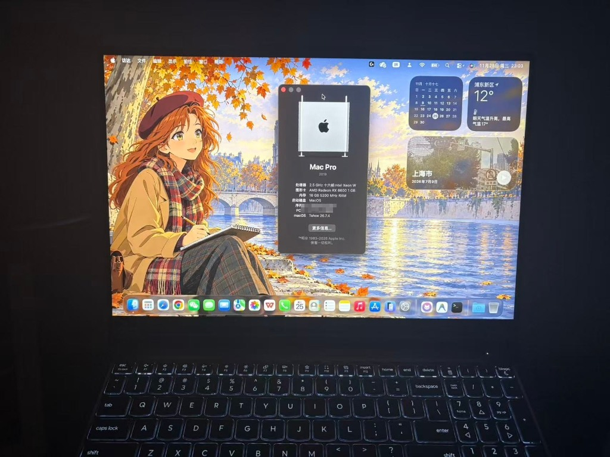
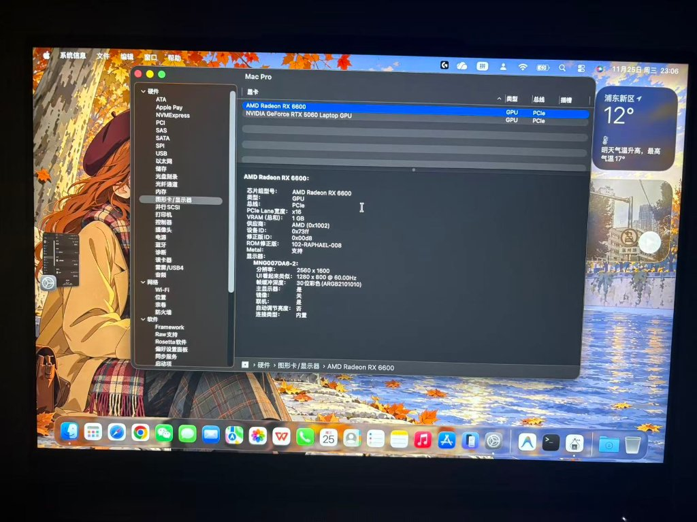

# Lenovo ThinkBook 16p 2025 (G6 ADR) Hackintosh EFI — AMD Radeon 610M 核显驱动分支 (`RembrandtGfx`, `v0.1.0-alpha`)

<p align="center">
  <a href="README.md">English</a> | <b>简体中文</b>
</p>

> **分支说明（`igpu-610m-rembrandtgfx` — 早期可用版 / Bring-Up `v0.1.0-alpha`）**
> - 本分支发布 **ThinkBook 16p 2025 G6 ADR (Ryzen 9 8945HX)** 的 **AMD Radeon 610M (`1002:164e`) 核显驱动 + 完整 OpenCore 1.0.9 引导 EFI**，基于 [caoshiyuan0211-blip/winmax2-2022-6800u-hackintosh](https://github.com/caoshiyuan0211-blip/winmax2-2022-6800u-hackintosh) 的 `RembrandtGfx` 移植适配 **Raphael (`gfx1036`)**（仿冒 Navi 23 `0x73ff` RX 6600），在 **macOS 26.7.4 (`25G422`)** 下启用 Metal 硬件加速，并兼容配合 **NullMoth 3.1** 启用 RTX 5060。
> - 如需日常稳定使用的 **独显直连（RTX 5060）** 正式版 EFI，请切换到 [`main`](https://github.com/Yangcheng811/ThinkBook-16p-2025-G6-ADR-Hackintosh/tree/main) 分支（`v1.1.0`）。
> - **隐私脱敏**：`EFI/OC/config.plist` 中 `PlatformInfo > Generic` 已还原为占位符，**使用前请自行生成 `MacPro7,1` 三码**。

---

## 实机截图（macOS 26.7.4 Tahoe — 混合 / 双显卡模式）

| 关于本机（`AMD Radeon RX 6600 1 GB`） | 系统信息（610M `0x73ff` Metal + RTX 5060） |
| :---: | :---: |
|  |  |

---

## 已完成进度（已验证生效）

- **AMD Radeon 610M（`1002:164e`, Rev `0xd8`, Raphael `gfx1036`, 2 CU）基础驱动与 Metal 加速可用**：
  - 完成 `RembrandtGfx.kext` 针对 Raphael 的移植（`0x164e` → `0x73ff` RX 6600、`KernelVersion::Tahoe`、替换 `linux-firmware` 的 `psp_13_0_5_*` / `gc_10_3_6_*` / `sdma_5_2_6` / `dcn_3_1_5_dmcub` 微码、SMU 13.0.5 消息号 `0x0A` / `0x17`、PowerPlay 时钟补丁 `wrapUpdateHWInfoClocks` 及禁用扫描输出 DCC `wrapShouldAllocScanoutDcc -> 0`）。
  - macOS 26.7.4 (`25G422`) 可正常进桌面（`2560 × 1600`, 30 位色深 ARGB2101010）并启用 **Metal 硬件加速**（`102-RAPHAEL-008`, `1 GB` VRAM）。
- **修复 DarkWake / 合盖触发的 ~21 秒黑屏**：
  - 在 `sleep.cpp` 中加入 `clamshell-sleep` 阻断（日志实测 `RembrandtGfx: sleep: clamshell-sleep block active`），启动阶段不再出现 DarkWake / `setOutputPowerState(1)` 导致的黑屏。
- **支持配合 NullMoth 3.1 启用 NVIDIA RTX 5060 Laptop GPU（`10de:2d59`, `17aa:8036`）**：
  - 已在 `config.plist` 中解除 `com.nullmoth.*` 屏蔽并配置 `nvfb=1 nvaccel=1 nvfbheads=4 -nvkmsnosmooth nmxaudio=2`，实测 `NVRM-xnu` 与 `NVAccel` 正常加载（`NVAccel: createUserGPUTask -> init=1`）。

---

## 已知问题与待办（Known Issues / TODO — Alpha 早期版本）

1. **【核心稳定性阻塞】灰屏 / `WindowServer` 看门狗超时死锁（已定位指令级根因）**：
   - **现象**：桌面静置或使用一段时间后可能突然灰屏/卡死，约 40 秒后触发 Watchdog 重启（`WindowServer.userspace_watchdog_timeout.spin`）。
   - **根因**：当触发 `IOAccelEventMachine2::hardwareErrorEvent()` 并通过 `AMDRadeonX6000_AMDAccelChannel::getHardwareDiagnosisReport` 调用 `AMDRadeonX6000_AMDNavi23Hardware::collect_stb(AmdStbInfo*)` 时，读取 STB 寄存器 `0xecc182` 与 `0xecc183` 得到非零且不等的值；循环计数超过 `0x7ff`（2048）后分支跳过重读 `0xecc182`，导致 `AMDRadeonX6000_AMDAccelEventMachine` 内核线程持锁死循环，进而锁死 `ws_main_thread` 和 `HIDEvents`。
   - **下个版本修复方案**：在 `probe.cpp` 中 hook `__ZN32AMDRadeonX6000_AMDNavi23Hardware11collect_stbEP10AmdStbInfo` 直接返回 `false`（已反汇编 `AMDRTHardware::writeSTBDiagnosisReport` 确认可安全释放 `0x400c` 缓冲区、无内存泄漏）。
2. **【显存瓶颈】610M 1024 MB UMA 显存易耗尽（`AMD ERROR! Failed to allocate`）**：
   - BIOS 给 610M 分配的 UMA 显存为 `FB: 1024 MB, Aper: 256 MB`（`ResizeAppleGpuBars` 无法扩大 BIOS 设定的 Aperture）。高分辨率下 `WindowServer` 与 Metal/Electron 应用会在 50–160 秒内快速耗尽 1024 MB 显存，进而更容易诱发渲染异常。如 BIOS 支持调大核显 UMA Frame Buffer Size（如 2GB/4GB），建议优先调大。
3. **其他已知遗留项**：
   - **内屏亮度最低全黑**：核显下将亮度调至最低仍会背光全黑。
   - **休眠尚未恢复验证**：当前测试配置通过 `-rmbnousb4sleep -rmbnohalt -rmbnomode2 -rmbnosleep -rmbnodispsleep` 规避休眠，完整 S3/合盖休眠仍属实验状态。
   - **部分短时重启（75–160s）**：待合入 `collect_stb` 死循环修复后再继续观察是否仍有独立重启诱因。

---

## 当前 EFI 配置摘要

- **`boot-args`**：
  ```text
  -v debug=0x100 keepsyms=1 nvfb=1 nvaccel=1 nvfbheads=4 -nvkmsnosmooth amfi_get_out_of_my_way=0x1 amfi=0x80 ipc_control_port_options=0 gfxrst=4 -vi2c-force-polling mtkfe=native mtknativeif=1 revpatch=sbvmm nmxaudio=2 ps2kbdonly=1 ps2rst=0 -lilubetaall -rmbnousb4sleep -rmbnohalt -rmbnomode2 -rmbnosleep -rmbnodispsleep
  ```
- **使用建议**：强烈建议先部署到**外接测试 U 盘（`OC_USB`）**试用，保留内置硬盘上稳定的 `main` 分支（RTX 5060 独显直连）EFI 不动。
- **校验状态**：`EFI/OC/config.plist` 已通过 `ocvalidate 1.0.9` 校验（0 issues，`ResizeAppleGpuBars = 0`）。

---

## 致谢（Credits）

- 上游核显驱动架构：[caoshiyuan0211-blip / winmax2-2022-6800u-hackintosh](https://github.com/caoshiyuan0211-blip/winmax2-2022-6800u-hackintosh)（`RembrandtGfx`）
- 其余平台组件与开源许可：见 `LICENSES/` 目录及 [`main` 分支文档](https://github.com/Yangcheng811/ThinkBook-16p-2025-G6-ADR-Hackintosh/blob/main/README.zh-CN.md)。
